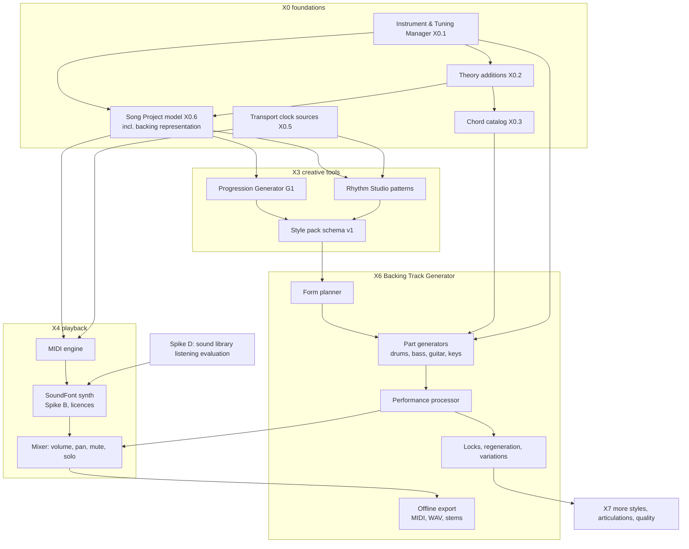

# Offline Backing Track Generator and Arrangement Studio

Architecture only, 2026-11-22. Jason approved this as an addition to the product scope (his specification, sections 1 to 15). **Not authorised for implementation.** No code, dependencies, sound assets or spikes until Jason authorises them. Roadmap placement and stage milestones: [master-roadmap.md](master-roadmap.md) (the authoritative feature inventory and sequence).

**Guiding principle (Jason):** the generator is judged by **how musical the finished arrangements sound**, not by how many instruments or styles it supports. Four convincing styles are worth more than twenty generic ones. A style that doesn't pass the listening tests in section 13 is held back, not shipped.

This document keeps two things apart throughout:

- **Approved requirements:** what the feature must do (Jason's specification).
- **Untested technology choices:** how it might be done (SoundFont synthesis, specific sample banks, offline rendering paths). These stay proposals until the spikes and listening tests in sections 6 and 13 confirm them. **Nothing here claims the audio will sound realistic; that can only be established by listening tests.**

## 1. Objective and scope

A guitarist chooses a style, key, tempo, chord progression and instruments, and PickWorks generates a complete, musically convincing backing arrangement, entirely offline, to practise, improvise or write songs over. It serves beginners and experienced players.

- **Explicit quality requirement:** avoid the thin, artificial General MIDI sound of older computer playback. Sound quality, natural phrasing and realistic articulation are acceptance requirements (section 13), not assumptions.
- **Not a DAW:** no multitrack audio recording here, no plug-in hosting, no mixing console beyond volume, pan, mute and solo, no mastering, no cloud services.
- **Fully offline:** all sounds bundled and licensed for offline redistribution; no CDN, streaming, cloud synthesis, online licence checks or mandatory internet connection.

## 2. An arrangement layer above the existing engines

The generator adds **no** second composition model, transport, progression generator or audio engine. It is an arrangement layer that reads and writes the shared structures:

| Needs | Provided by (existing design) |
| --- | --- |
| Song structure, harmony, meter, tempo, feel, sections, repeats | Song Project composition model ([composition-model.md](composition-model.md)) |
| Chord progressions | Chord Progression Generator ([creative-workstation.md](creative-workstation.md) section 5) |
| Strumming and picking patterns | Rhythm & Strumming Studio patterns (`RhythmPattern`, composition-model.md section 8) |
| Instrument definitions, ranges, tunings, guitar voicings | Instrument & Tuning Manager and the chord catalog |
| Note scheduling and performance | MIDI engine (X4) |
| Sampled instrument sound | SoundFont synthesizer on the shared AudioContext (X4, pending Spike B) |
| Tempo, sync, looping, playback | Shared transport ([transport-timing.md](transport-timing.md)) |
| Saving and reuse | Song Project files, Personal Songbook, Songwriting Studio |
| Undo, redo, autosave, recovery | The one operations engine (composition-model.md section 11) |

### Dependency diagram



(In words: X0 gives the shared model and instruments; X3 gives progressions, rhythm patterns and the style-pack schema; X4 gives playback and mixing; X6 adds generation, regeneration and export; X7 adds styles and quality.)

## 3. Generator controls (ADHD-friendly)

**Easy mode** (the default, one screen, no scrolling on a laptop):

- Musical style, key with a major/minor switch, tempo, track length, instrument selection (tick boxes with friendly names).
- **Generate**, **Play**, **Stop**, **Regenerate**.
- **Save to Song Project**.

**Advanced mode** (behind an "Advanced" button, opening a side panel on wide screens and a bottom sheet on phones; grouped into collapsible sections so only one group is open at a time):

- **Harmony:** chord progression selection (from the Progression Generator or saved progressions) or custom entry; time signature.
- **Feel:** groove, rhythmic feel, straight or swing timing.
- **Arrangement:** complexity, intro and ending options, section structure, fill frequency, humanization amount.
- **Instruments:** voicing per instrument, sound choice, add or remove instruments, regenerate or lock each instrument.
- **Mix:** volume, pan, mute and solo per instrument.
- **Playback:** loop region, playback preset (section 7).

Rules that keep beginners comfortable: Easy mode never shows Advanced controls; every Advanced control has a sensible default from the style; changing an Advanced value never forces a full regeneration without saying so; a "Reset to style defaults" button undoes all Advanced choices at once.

## 4. Styles as versioned data packs

**First release styles, matching the Progression Generator:** rock, blues, pop and folk/acoustic. **Later packs:** country, worship, jazz, southern rock, classic rock, funk, ballads (X7). The first implementation is not expanded to every style.

**Style pack schema** (one JSON file per style in `content/styles/`, versioned; the Progression Generator's `styles/*.json` and the backing style share one file so harmony and arrangement rules never disagree):

```ts
StylePack {
  id; name; version; schemaVersion;
  harmony: { ...progression-generator rules (creative-workstation.md section 5) };
  tempo: { min; max; default }; meters: Meter[]; feel: { type; ratio? };
  sectionRoles: { intro; verse; chorus; bridge; solo; ending };      // energy level and density per role
  instruments: { role: 'drums' | 'bass' | 'rhythm-guitar' | 'keys' | ...; defaultSound; register; defaultOn }[];
  drums: { grooves: Groove[]; fills: Fill[]; intros: Pattern[]; endings: Pattern[] };
  bass: { behaviours: ('root' | 'root-fifth' | 'walking' | 'pedal' | ...)[]; approachRules; rhythmLock: 'kick' | 'beat' | 'free' };
  guitar: { patterns: RhythmPatternRef[]; voicingRules; muteRules };
  keys: { comping: Pattern[]; voicingRules; register };
  complexity: { level: 1 | 2 | 3; ...switches per level };
  mixDefaults: { volume; pan; reverbSend }[];
  presets: { practice; natural; performance };                        // performance-processing parameters (section 7)
}
Groove { id; bars; steps: { piece: 'kick' | 'snare' | 'hat-closed' | 'hat-open' | 'ride' | 'crash' | ...;
         at: ticks; velocity: { base; range }; probability?; variationGroup? }[] }
```

- Style packs are bundled data, validated at build time (every groove fills its meter, every reference resolves, every pattern stays in range), versioned like the chord catalog and never changed silently under a saved arrangement (saved arrangements record the pack id and version).
- A pack is accepted for release only after its listening tests pass (section 13).

## 5. Arrangement generation engine

Generation is **rule-based and deterministic**, not random note distribution. Pipeline:

1. **Inputs:** the song's harmony track, conductor (meter, tempo, feel, key), arrangement (form) and the chosen style pack, settings and seed. In Easy mode with no song yet, the engine first asks the Progression Generator for a progression and creates a simple form (intro, verse, chorus, verse, chorus, ending) in a new Song Project.
2. **Form planner:** gives every section instance a role (intro, verse, chorus, bridge, ending) and an energy level from the style, plans where fills go (the last bar or half-bar before a section change, scaled by fill frequency) and plans the intro and ending.
3. **Shared groove grid:** for each section, a kick-and-accent map from the chosen drum groove. Bass and rhythm parts read it, so the band locks together rather than each part being generated independently.
4. **Part generators** (one per instrument role, a common interface, so a new instrument is a new generator and data, not a redesign):

```ts
PartGenerator { role; generate(ctx: { harmony; conductor; form; grooveGrid; instrument; style; settings }, seed): GeneratedPart }
```

   - **Drums:** style grooves with kick, snare, hi-hat, ride and cymbal patterns; velocity variation inside each groove's ranges; variation groups so a 4-bar phrase isn't repeated identically for too long; fills at section boundaries; crash on downbeats of new sections; intro count-ins and ending patterns (final hit or ritardando).
   - **Bass:** root patterns, root-fifth movement, walking bass (blues and, later, jazz), passing and approach tones on weak beats leading into the next chord, rhythm locked to the kick from the groove grid, notes kept within the instrument definition's playable range (standard 4-string E1 to about G3 by default) with smooth transitions (smallest interval to the next target unless the style asks for octave jumps).
   - **Rhythm guitar:** strumming from Rhythm Studio patterns, muted strokes (chucks), arpeggios and fingerpicking that follow the actual chord's strings, voicings from the chord catalog chosen for smooth movement and the style (open chords for folk, power chords and barre shapes for rock), stroke direction recorded for string-by-string timing at playback.
   - **Piano and keys:** chord accompaniment, broken chords, rhythmic comping, voicings in a style-appropriate register with voice leading (common tones kept, smallest movement), left hand avoiding the bass's register when bass is present.
5. **Performance processor** (section 6): velocities, articulations and note lengths appropriate to each instrument and the style.
6. **Output:** generated clips in the Song Project (section 9). Nothing is stored outside the model.

**Harmony compliance:** every pitched note is a chord tone, an allowed tension for the style and complexity, or a passing or approach tone on a weak beat resolving by step; this is checked automatically (section 13). Every part follows the song's harmony, meter (including changes and pickups), tempo, feel and arrangement, including endings and per-instance overrides.

**Determinism:** each part's seed is derived from the arrangement's root seed and the part id; the same inputs, style version and seeds always give identical output on Windows and Android. Regenerating one part changes only that part's seed.

## 6. Natural instrument playback

**What each realism lever depends on.** A SoundFont does not automatically provide every articulation.

| Lever | Depends on the sample library | Depends on the synthesizer | Depends on performance-generation logic |
| --- | --- | --- | --- |
| Quality multisampled instruments | Yes: number and quality of samples per pitch | Loads and plays them | — |
| Velocity layers | Yes: separate samples per dynamic level | Must support velocity-switched zones | Must produce varied, musical velocities |
| Articulations (palm mute, dead note, slide, ghost note, open and closed hi-hat, rim shot) | Yes: needs separate samples or programs for each | Must switch zones or programs (key switches or separate presets) | Must choose articulations musically |
| Humanised timing | — | Must schedule sample-accurately | Small, seeded timing offsets at playback |
| Realistic note lengths | Natural decay in samples | Release envelopes | Generator sets lengths (let ring vs choked) |
| Strum direction and staggered string attacks | Separate up and down samples help; not required | Plays each string as its own note | Generator writes one note per string; playback spreads attacks (about 5 to 30 ms across strings by tempo and dynamics), low-to-high for downstrokes, high-to-low for upstrokes |
| Muted and sustained notes | Muted samples needed for convincing chucks and palm mutes | Zone switching | Generator writes mute articulations |
| Natural drum variation | Round-robin samples (several hits per piece and velocity) avoid the "machine gun" effect | Must support round-robin or random zone selection | Velocity variation and groove variation groups |
| Reverb and effects | Impulse responses for convolution reverb (licensed) | WebAudio ConvolverNode, light compression and simple EQ on the shared output | Preset chooses amounts |
| Voice management and polyphony limits | Long sustains increase voice count | Voice stealing (release-phase voices first, then quietest; never steal kick, snare or bass) and a polyphony cap per device | Generator avoids needless overlapping notes |

**General SoundFont vs dedicated guitar and drum banks (to be evaluated, not assumed):** general-purpose General MIDI SoundFonts usually have few velocity layers, no round-robin drums and no guitar articulations, which is a large part of the "thin" sound Jason wants to avoid. Dedicated, locally bundled banks (a multi-velocity, round-robin drum kit; a steel-string and electric guitar set with up and down strums and mutes; a sampled acoustic bass and electric bass; a sampled piano) are likely to improve realism materially, at the cost of size and memory. This is tested in **Spike D** (below). Formats: the preferred synthesizer path plays SF2 and SF3; banks only available in other formats (for example SFZ) would need conversion or a different player, which Spike D must report.

**All sounds must be licensed for offline redistribution**, verified by the procedure in creative-workstation.md section 3. The synthesizer's software licence and the licences of the instrument samples are separate and both must be verified; a free synthesizer doesn't make its sounds free to redistribute.

### Spike D: sound library listening evaluation (not authorised)

- **Purpose:** decide whether a general SoundFont is enough or dedicated guitar, bass, drum and piano banks are needed, and which candidate sets to use.
- **Method:** render the four reference arrangements in section 13 with each candidate sound set through the candidate synthesizer, at fixed seeds and loudness-normalised; run the listening rubric blind; measure size, load time and memory on the reference laptop and a mid-range Android tablet.
- **Pass criteria:** the chosen set reaches the listening thresholds in section 13; sound set ≤ 250 MB installed on Windows (full set) and ≤ 80 MB loaded in memory on Android (lite set); every file's licence verified for offline redistribution.
- **Timing:** before X4's sound set is fixed (so playback isn't built around a set that can't pass) and again before X6 release.

## 7. Playback quality presets

Three optional presets change **only how an arrangement is rendered when played or exported**. They never change chords, notes, the progression or any Song Project data; switching presets is not an edit and doesn't enter undo history (the chosen preset is saved as a playback preference on the arrangement).

| Preset | Purpose | Rendering |
| --- | --- | --- |
| **Practice** | Clear, consistent sounds and predictable timing for learning | No timing humanisation; even strum spread; reduced velocity variation; no effects except a little room reverb; clear separation (bass and drums slightly forward) |
| **Natural** | Musical phrasing, realistic articulation, subtle humanisation | Seeded timing humanisation (a few milliseconds, style-dependent), full velocity variation, articulations and round-robin, natural strum spread, modest reverb |
| **Performance** | Natural articulation with optional effects and more expressive playback | Natural plus optional effects (more reverb, light drive on electric guitar where the sound set supports it, compression on the mix) and more expressive dynamics such as section-based swells. It does not add notes: more expressive *arrangements* come from the complexity setting, which is an explicit regeneration |

Low-Power Field uses Practice by default (least processing); administrators and students can choose another if allowed.

## 8. Arrangement editing and regeneration

Users can:

- generate a complete backing track;
- **lock the chord progression** (the harmony events used by the backing are locked; the Progression Generator's lock rules apply);
- **regenerate only the drums, bass, guitar or keyboard**;
- **lock individual instrument parts** (a locked part is never changed by regeneration);
- change instrument sounds (a sound choice; notes unchanged);
- adjust tempo (a conductor change; no regeneration needed);
- mute and solo instruments; loop selected sections (transport loop);
- change complexity (regenerates unlocked parts at the new level, after showing what will change);
- add or remove instruments (adding generates only the new part; removing keeps it recoverable through undo and variations);
- save multiple arrangement variations and restore a previous version;
- send the arrangement to Songwriting Studio (the backing already lives in the Song Project, so this opens the song there; from a standalone Easy-mode session it first saves a new Song Project).

**Deterministic generation:** saved seeds and the style pack id and version reproduce an arrangement exactly. If the installed style pack is newer than the one used, the saved arrangement still plays exactly as saved (its notes are stored); "Regenerate with the new style version" is an explicit action.

**Interaction with undo, redo, autosave and revisions:**

- Generate, regenerate (whole or one part), complexity change, add or remove instrument and "update after chord change" are each **one compound operation** in the shared operations engine: one undo step restores the exact previous parts, seeds and settings.
- Every such operation is journalled within 2 seconds like other edits (autosave), so a crash never loses a generated arrangement.
- **Variations** are named snapshots of the backing (parts, seeds, settings and mix) stored inside the Song Project (`backings[]`, section 9). Restoring a variation is itself an undoable operation. Variations are separate from **song revisions** (whole-file history in `revisions/`): saving a revision captures every variation as it stands.
- Undo history is per open song and shared with all other editors, so undoing in the TAB view can undo a regeneration if it was the last operation (the history list names each step, for example "Regenerated drums").

## 9. Song Project integration

A backing track is part of the Song Project, never an unrelated audio file. Rendered audio (WAV) is an export or an optional cached file in `media/`, never the source of truth.

**Representation (extends composition-model.md; full definitions there, section 7a):**

```ts
SongProject.backings: BackingArrangement[]         // saved variations; one is active
BackingArrangement { id; name; active; styleRef: { packId; version }; rootSeed; settings: { complexity; fills; humanize;
                     intro; ending; feelOverride? }; preset: 'practice' | 'natural' | 'performance';
                     parts: BackingPart[]; mix: { partId; volume; pan; mute; solo }[]; createdAt; basedOn?: backingId }
BackingPart { id; role; instrumentId; sound; generator: { id; version }; seed; locked: boolean; hasEdits: boolean;
              harmonyFingerprint: { sectionId; bar; hash }[] }
```

- **Generated instrument parts and MIDI events:** each part's notes are ordinary **clips** in each section (composition-model.md section 7), marked with `source: { backingId, partId }`. They are the same events TAB, notation and MIDI use, so a generated guitar or bass part can be opened in the TAB editor (X5) and played by the MIDI engine with no conversion. Drum parts are clips on a drum instrument whose notes use General MIDI drum numbers.
- **Instrument assignments:** `instruments[]` entries with a role, tuning, sound and range from the Instrument & Tuning Manager; each `BackingPart` names its instrument.
- **Style and groove metadata, seeds, locked parts:** on `BackingArrangement` and `BackingPart` as above.
- **Arrangement sections:** the backing follows the song's own `arrangement[]` and sections; it adds no second form. Because one section can be played several times, per-instance differences (a fill before the second chorus, an ending) are **instance overlays**: small clips that replace specific bars for one arrangement entry and pass only (composition-model.md section 7a).
- **User edits:** editing a generated event marks it `edited: true` and its part `hasEdits: true`. Edited events are preserved by regeneration unless the user confirms otherwise.
- **Saved variations:** separate `BackingArrangement` entries with their own clips (identified by `backingId`), so variations never overwrite one another. Only the active one plays.

**When the song changes:**

| Change | Behaviour |
| --- | --- |
| Key (transpose song) | **Automatic.** Generated and edited pitched parts transpose exactly with the rest of the song (as every clip does); drums unaffected. No regeneration. |
| Tempo | **Automatic** (playback follows the conductor). No regeneration. |
| Swing or feel | **Automatic** at playback (feel is applied when scheduling). |
| Chord progression (harmony edits) | **Requires regeneration, never automatic.** Bars whose harmony fingerprint no longer matches are marked "out of date" in the arrangement view. One tap, **Update backing**, regenerates only unlocked, unedited material in the affected bars with the same seeds. Locked parts and edited bars are kept and flagged "may clash with the new chords". |
| Meter or section structure | Parts follow the composition model's meter-change rules (keep bar lines or re-bar); affected bars are marked out of date with the same Update action. |
| Sections added, removed or reordered | Reordering needs nothing (the backing follows the form). New sections are empty for the backing until Update fills them; removed sections take their backing clips with them (undoable). |

**No silent overwrites:** any regeneration that would change an edited event or a locked part is refused unless the user confirms in a dialog that lists exactly which parts and bars would change. The default action always preserves edits.

## 10. Offline export

| Export | Details |
| --- | --- |
| **Standard MIDI File** | Type 1, one track per part, tempo, meter and key maps, markers for sections, General MIDI programs, drums on channel 10, articulations as key switches or controller data where defined; pickups and endings unrolled from the flattened timeline. |
| **WAV, full backing mix** | Rendered locally from the same synthesizer, sound set, preset and mix, faster than real time, without playing through speakers or a recording loop. 44.1 or 48 kHz, 16 or 24 bit. |
| **WAV stems** | One file per instrument part, rendered the same way, starting at the same point, so they line up in any other program. |
| **Song Project export and restore** | The backing is inside `project.json` (notes, seeds, settings), so it exports and restores with the song (composition-model.md section 14). Rendered WAV files in `media/` go with the song only if the user kept them. |
| **FLAC** | Later optional format (royalty-free), after WAV. |

**Rendering approach (untested; confirmed by Spike B):** render through an OfflineAudioContext (or the synthesizer's own offline render mode) using the same tick-to-time conversion as the transport. To bound memory, render in segments (about 30 seconds with overlapping tails for reverb and decays) and stream each segment to Rust, which writes the WAV incrementally. Stems render one at a time.

**Resource behaviour:**

- **CPU:** target at least 4 times faster than real time for a full mix on the reference laptop; rendering runs only on request and shows progress.
- **Memory:** segment rendering keeps peak use near the sound set plus a few segments, not the whole song (a 3-minute stereo float buffer alone is about 70 MB per stem, which is why whole-song rendering is avoided).
- **Storage:** the size is estimated and shown before rendering (about 50 MB per 3-minute stereo stem at 48 kHz/24-bit) and free space is checked first.
- **Cancellation:** a Cancel button stops rendering at the next segment; partial files are deleted.
- **Interrupted export:** files are written as `.partial` and renamed only when complete and verified; leftovers are removed on the next start (operating-profiles.md lifecycle table). On Android, rendering pauses if the app is backgrounded and must be restarted when it returns (no hidden background rendering).

## 11. Operating profiles and Android

| Profile | Behaviour |
| --- | --- |
| **Full Studio** | Complete generation, editing, playback and export. |
| **Low-Power Field** | Generation and editing available (generation is pure computation). Sound libraries load only when playback or rendering is requested and unload after the profile's idle time; no background synthesis; Practice preset by default; export allowed with a battery notice. |
| **No-Power Preparation** | View and print existing arrangement charts (sections, bars, chords, drum and strum pattern names, instrumentation) without initialising audio. Generation of new arrangements is allowed only as the lightweight data step (no audio, no rendering), so a student can plan and print a chart; playback and export are not available. |

**Android (documented now, verified only on real devices later):**

- **Memory budget:** a **lite sound set** (target ≤ 80 MB loaded) for phones and mid-range tablets; the full Windows set is not assumed to fit every device. The app picks the set from available memory and lets the student choose.
- **Audio latency:** output latency varies by device and is much higher with Bluetooth; playback highlighting is latency-compensated (transport-timing.md); a notice suggests wired headphones for playing along.
- **Battery:** playback and rendering are the heaviest tasks; both run only on request; measured on real devices against the operating-profile measurement plan.
- **Background behaviour:** playback stops when the app goes to the background or the screen turns off (android-platform.md); rendering pauses and must be restarted.
- **Storage limits:** free-space checks before rendering; WAV stems can be large, so the default export on phones is the full mix only.
- **Export handling:** through the system document picker or share sheet; MIDI and WAV files are standard formats any Android app can open.

## 12. Roadmap integration (no new phase)

| Stage | Backing-track work |
| --- | --- |
| **X0 Foundations** (X0.1, X0.6) | Song Project schema represents backings, generated parts, instrument assignments, instance overlays, edit flags and reproducible generation metadata (seeds, style and generator versions). Schema and tests only. |
| **X3 Creative tools** | Progression Generator G1 and Rhythm Studio patterns produce exactly the data the arrangement engine will consume; the **style pack schema v1** (shared with the generator) is defined and validated, including groove fields, even though only harmony and rhythm fields are used yet. |
| **X4 Playback** | MIDI and SoundFont playback foundations: load, play, loop, mute, solo and mix existing arrangements (volume and pan), Practice preset, polyphony and voice management. Spike B (including offline rendering) and Spike D (first pass) before the sound set is fixed. |
| **X6 Backing Track Generator** | Arrangement generation (form planner, groove grid, part generators for drums, bass, rhythm guitar and keys), performance processing, Natural and Performance presets, locks, regeneration, variations, editing, Update after chord changes, offline MIDI, WAV and stem export; four styles (rock, blues, pop, folk/acoustic) passing section 13. |
| **X7 Expansion** | Advanced styles as data packs (country, worship, jazz, southern rock, classic rock, funk, ballads), more articulations, quality improvements based on listening-test results, FLAC export. |

Phase 2 learning priorities keep their protection: none of this runs in place of Phase 2 work.

## 13. Sound-quality and performance acceptance testing

No claim that the audio is realistic is made until these tests have actually been run.

**Reference arrangements** (fixed progressions, tempos and seeds, stored as test fixtures):

1. **Twelve-bar blues** in A, shuffle feel, about 100 BPM: drums, bass (walking or root-fifth), rhythm guitar.
2. **Rock progression** (for example I–bVII–IV–I in E) at about 120 BPM: realistic drum groove, electric bass, rhythm guitar.
3. **Acoustic folk progression** (for example I–V–vi–IV in G) at about 90 BPM: natural steel-string strumming, optional light percussion and bass.
4. **Pop progression** (for example vi–IV–I–V in C) at about 105 BPM: piano, bass and drums.

**Measurable technical criteria:**

| Criterion | Threshold |
| --- | --- |
| Timing: every rendered onset vs its calculated time (before humanisation) | ≤ 1 ms in offline render; ≤ 5 ms in live playback against the transport |
| Synchronisation: parts and stems | Stems start at the same sample; the sum of stems matches the full mix (null test residual ≤ −60 dB, effects off) |
| Harmony compliance | 100% of pitched notes are chord tones, allowed tensions, or weak-beat passing or approach tones resolving by step |
| Range compliance | 100% of notes within each instrument definition's playable range; guitar voicings pass `validateShape` |
| Structure | Fills occur only at planned boundaries; intros and endings present when chosen; every bar's durations fill the meter |
| Repetitiveness | No identical 4-bar drum phrase more than 4 times in a row without variation; no identical bar of velocities repeated more than 8 times |
| Determinism | Same inputs and seeds give byte-identical clips on Windows and Android builds; regenerating one part leaves the others byte-identical |
| Audible artifacts | Zero clicks, dropouts or clipped samples (peak ≤ −1 dBFS before limiting) detected in render analysis |
| CPU and memory | Live playback of a 4-part arrangement within Spike B's thresholds; offline full-mix render ≥ 4× real time on the reference laptop; peak memory within the sound-set budget plus 150 MB |
| Battery | 30 minutes of playback measured against the metronome-only baseline on the reference laptop (and Android devices later); recorded, with Low-Power Field showing a measurable saving |
| Offline | All tests pass with networking blocked |
| Export accuracy | MIDI export re-imported gives the same notes, timing and tempo map; WAV export matches live playback within the null-test threshold (humanisation seeded identically) |

**Repeatable human listening rubric:**

- **Panel:** Jason plus at least two guitarists (one beginner-to-intermediate, one experienced).
- **Setup:** loudness-normalised renders of the four reference arrangements in the Natural preset, on the same playback device, fixed seeds; candidates presented blind and in random order (for example two sound sets or two builds).
- **Scores 1 to 5:** instrument realism (per instrument), groove and feel, musical coherence (do the parts fit the chords and each other), repetitiveness, audible artifacts, and "Would you practise or write with this?".
- **Pass bar for a style:** average ≥ 4.0 for groove and feel, coherence and "would practise with it"; no category averaging below 3.5; no panel majority describing it as "artificial" or "General MIDI-like".
- **Recording:** scores, comments, build, sound set and seeds are saved with each test run, so results can be compared between builds.
- **Release rule:** each of the four first styles must pass on its own. A failing style is held back for improvement rather than released.

## 14. Unresolved technical decisions and risks

**Decisions needing Jason's approval (later, before the stages named):**

1. Authorise **Spike D** (sound library listening evaluation), in addition to Spikes A to C (before X4's sound set is fixed).
2. Approve the **sound-set budgets** (≤ 250 MB full set on Windows, ≤ 80 MB lite set on Android) or set others.
3. Approve the **listening panel and pass bar** in section 13.
4. Choose whether rendered WAV files may be kept inside the Song Project's `media/` folder (larger backups) or are export-only (my recommendation: export-only by default, keep optional).

**Technical risks:**

- **Realism depends on sample quality more than code.** Redistributable multi-velocity, round-robin guitar and drum banks may be scarce, large or unclear in licence. Mitigation: Spike D early, licence verification, and holding back styles that don't pass.
- **Synthesizer capabilities** (velocity-switched zones, round-robin, key switches, offline rendering) are unverified for the preferred WebAudio synth. Mitigation: Spike B tests each explicitly.
- **Memory and CPU on Android** for multi-instrument playback. Mitigation: lite sound set, polyphony caps, measurement.
- **Generated music sounding repetitive or mechanical.** Mitigation: variation groups, form-aware fills, measurable repetitiveness limits and listening tests.
- **Edit preservation complexity** when chords change. Mitigation: per-bar harmony fingerprints, edit flags, and confirmation before any overwrite.
- **Timing when the window is hidden** (transport-timing.md); rendering is unaffected because it is offline.

## 15. Approved requirements vs untested technology choices (summary)

| Approved requirement | Proposed technology, untested |
| --- | --- |
| Fully offline generation, playback and export | WebAudio SoundFont synth (Spike B), offline rendering through OfflineAudioContext or the synth's render mode |
| Realistic, non-GM sound | Dedicated guitar, bass, drum and piano banks vs a general SoundFont (Spike D) |
| Deterministic, reproducible arrangements | Seeded generators (existing `seededRng`) and versioned style packs |
| One shared model, transport and audio engine | Composition-model backings, clips and overlays; shared transport; shared AudioContext |
| Practice, Natural, Performance presets that never change song data | Render-time parameters only |
| Locks, per-instrument regeneration, variations, undo | Shared operations engine with compound operations |
| MIDI, WAV and stem export, interrupted-export safety | SMF writer; segmented rendering streamed to Rust `.partial` files |
| Profile and Android behaviour | Capability flags; lite sound set; foreground-only playback and rendering |
| Sound-quality acceptance | Section 13 technical criteria and listening rubric |
